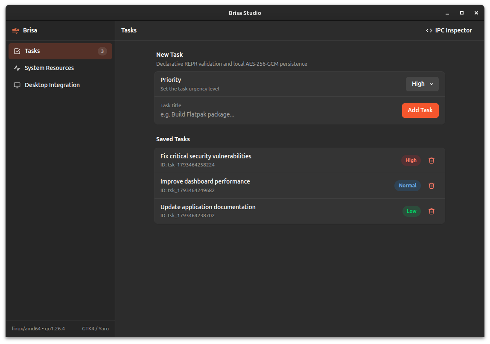
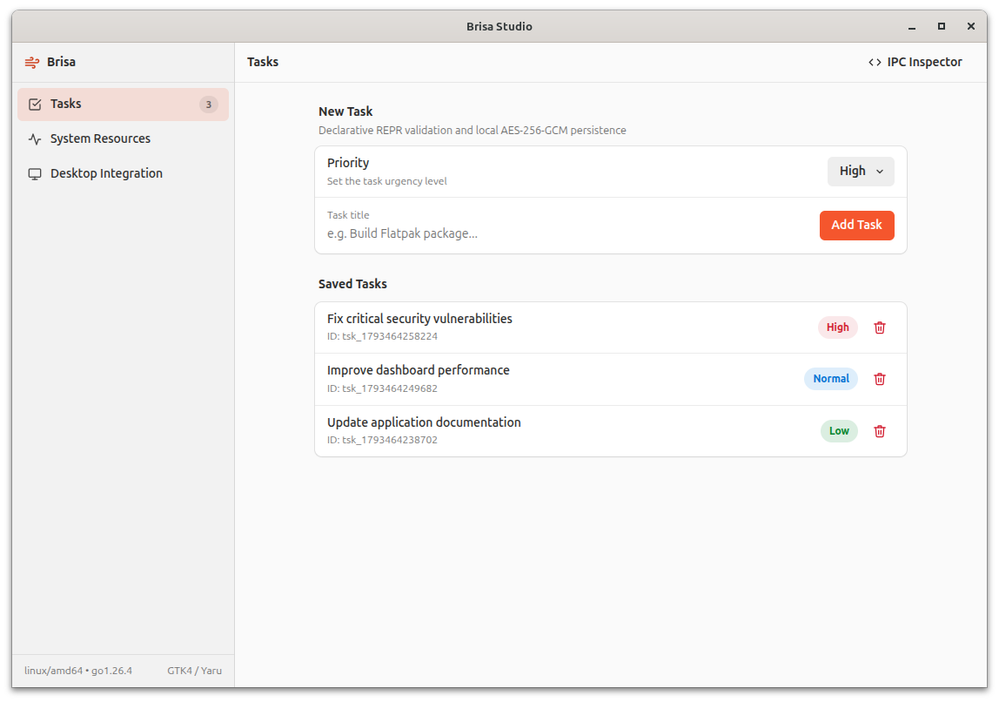

<div align="center">
	
</div>

<h1 align="center">Brisa Framework 🌬️</h1>

<div align="center">

[](go.mod)
[](LICENSE)
[](https://deviq.com/design-patterns/repr-design-pattern/)
[](core/theme.go)
[](go.mod)
[-purple>)](go.mod)

</div>

**Brisa** is an ultra-lightweight desktop application micro-framework for Go with **zero external dependencies**, featuring **100% pure Go compilation (`CGO_ENABLED=0`) on Linux & Windows** and a **native Apple WebKit engine on macOS**.

Built by the creator of [Gota 💧](https://github.com/carlosxfelipe/gota), Brisa brings the **REPR Design Pattern (Request-Endpoint-Response)** to desktop IPC and ships with **5 built-in desktop themes** (GNOME Libadwaita, Ubuntu Yaru, KDE Plasma, macOS Aqua, and Windows 11 Fluent) that synchronize instantaneously with your operating system's Light and Dark mode—without bundling 150MB+ of Electron/Node.js or requiring heavy CGO toolchains on Linux & Windows.

<p align="center">
  
  
</p>

---

## ✨ Key Features

- **Zero External Dependencies & Multiplatform Engine**: Built 100% on the Go standard library with zero external `go.mod` dependencies. Uses **100% Pure Go (`CGO_ENABLED=0`)** on Linux & Windows via Chromium/CDP, and native **Apple WebKit (`WKWebView`)** on macOS for a 100% native desktop experience.
- **Built-in Desktop UI Kit & 5 Themes**: Ships with 5 pre-configured desktop themes (GNOME Libadwaita, Ubuntu Yaru, KDE Plasma Breeze, macOS Aqua, Windows 11 Fluent) providing ready-to-use CSS components (`.adw-split-view`, `.boxed-list`, `.adw-row`, `.adw-entry-input`, `.gtk-btn`, `.suggested-action`, etc.) crafted to match each desktop environment's look & feel.
- **OS-Governed Light & Dark Mode (<1ms Latency)**: Strictly governed by the operating system—synchronizes in real time with GNOME (`stdbuf -oL gsettings monitor org.gnome.desktop.interface color-scheme`), macOS (`AppleInterfaceStyle`), Windows Registry, and `@media (prefers-color-scheme)`.
- **REPR Desktop IPC Bridge**: Typed command registration (`brisa.Bind`, `brisa.BindEndpoint`, `brisa.BindService`) with automatic JSON payload binding and declarative struct tag validation (`validate:"required,min=3,oneof=..."`).
- **Auto-Generated JS & TypeScript SDK**: Serves `/brisa/sdk.js` at runtime (automatically injected into `index.html`) exposing `brisa.call.<group>.<command>()`, `brisa.invoke()`, `brisa.batch()`, and generates `.d.ts` definitions at `/brisa/types.d.ts`.
- **Built-in Interactive IPC Inspector**: Inspired by GNOME D-Spy and Gota's Scalar Docs, Brisa includes a zero-dependency interactive Desktop IPC Playground & Live SSE Event Monitor at `/brisa/inspector`.
- **Encrypted Local Store**: Built-in persistent key-value and JSON configuration store (`ctx.Store()`) backed by atomic file writes and optional **AES-256-GCM encryption** at rest.
- **Native OS Integration**: Cross-platform Window control (resize, move, minimize, maximize, fullscreen, title, JS eval), dynamic Dock/Taskbar icons, File/Directory/Message Dialogs, Clipboard, and Desktop Notifications.

> 📖 Looking for in-depth architecture patterns, GTK4 CSS classes, validation rules, and AI coding guidance? See [llms.txt](llms.txt).

---

## ⚡ Architecture: Why Brisa Instead of Electron?

Traditional desktop web frameworks like **Electron** bundle an entire copy of Chromium and Node.js inside every application binary (~150 MB to 250 MB per app). Other Go desktop frameworks rely on **CGO** (`webkit2gtk-4.1` C headers, `gcc`, complex cross-compilation toolchains) and heavy external dependency trees.

**Brisa takes the best of both worlds—engineered with zero external `go.mod` dependencies:**

1. **No Bundled Browser Engine (~5–8 MB Single Binary)**: Your compiled binary contains only your Go code and embedded UI assets (`embed.FS`).
2. **Native Apple WebKit on macOS (`WKWebView`)**: On macOS, Brisa instantiates an official Cocoa `NSWindow` with `WKWebView`, providing a 100% native Mac experience (Dock icon, menu bar, window minimization/restoration, and ~30 MB RAM) without opening or depending on Chrome.
3. **Chromium App-Mode on Linux & Windows (`CGO_ENABLED=0`)**: On Linux and Windows, Brisa automatically finds an existing Chromium-based engine (Chrome, Chromium, Brave, Edge) and launches an isolated, chromeless desktop window (`--app`) with pure-Go Chrome DevTools Protocol (CDP) WebSocket window control—100% Pure Go with zero CGO required.

| Feature                       | Electron         | CGO WebView Frameworks           | **Brisa 🌬️**                                                     |
| :---------------------------- | :--------------- | :------------------------------- | :--------------------------------------------------------------- |
| **Binary Size**               | ~150 MB – 250 MB | ~15 MB – 40 MB                   | **~5 MB – 8 MB**                                                 |
| **External `go.mod` Deps**    | N/A (Node/npm)   | Dozens of packages               | **0 (100% Go stdlib)**                                           |
| **Requires CGO / C Compiler** | N/A              | Yes (`gcc`, GTK/WebKit headers)  | **No on Linux/Windows (`CGO_ENABLED=0`)**; Native on macOS       |
| **Browser Engine**            | Bundled per app  | OS WebKit / WebView2 (via C FFI) | **Native WKWebView (macOS) / System Chromium (Linux & Windows)** |
| **IPC Architecture**          | Untyped channels | Custom / reflection bindings     | **Typed REPR + Auto Validation**                                 |
| **Built-in UI Kit**           | None             | None                             | **5 Desktop Themes (GNOME, Ubuntu, Plasma, macOS, Win11)**       |

---

## 📦 Installation

Initialize your Go module:

```bash
go mod init mydesktopapp
```

Install Brisa:

```bash
go get github.com/carlosxfelipe/brisa
```

Requires Go 1.26 or newer.

---

## 🚀 Quickstart (REPR Desktop Pattern + Built-in UI Kit)

Create a `main.go` file:

```go
package main

import (
	"log"

	"github.com/carlosxfelipe/brisa"
)

// 1. Request DTO with declarative validation
type GreetRequest struct {
	Name string `json:"name" doc:"User name" example:"Carlos" validate:"required,min=2"`
}

// 2. Response DTO
type GreetResponse struct {
	Message string `json:"message" example:"Hello, Carlos! Welcome to Brisa 🌬️"`
}

func main() {
	app := brisa.New(brisa.Config{
		AppID: "com.example.hello",
		Title: "Hello Brisa",
		Window: brisa.WindowConfig{
			Width:  900,
			Height: 580,
		},
		IndexHTML: `<!DOCTYPE html>
<html lang="en" translate="no">
<body>
  <main class="adw-page">
    <div class="adw-clamp">
      <div class="adw-group">
        <div class="adw-group-title">Welcome to Brisa</div>
        <div class="boxed-list">
          <div class="adw-row">
            <div class="adw-row-text">
              <div class="adw-row-subtitle">Your name</div>
              <input id="name" class="adw-entry-input" placeholder="Enter your name..." />
            </div>
            <div class="adw-row-suffix">
              <button class="gtk-btn suggested-action" onclick="sayHello()">Greet</button>
            </div>
          </div>
          <div class="adw-row">
            <div class="adw-row-text">
              <div class="adw-row-title" id="out">Waiting for IPC call...</div>
            </div>
          </div>
        </div>
      </div>
    </div>
  </main>
  <script>
    async function sayHello() {
      const name = document.getElementById("name").value;
      const res = await brisa.call.users.greet({ name });
      document.getElementById("out").textContent = res.message;
    }
  </script>
</body>
</html>`,
	})

	// 3. REPR Desktop Command
	brisa.Bind(app, "users.greet", func(ctx *brisa.Context, req GreetRequest) (GreetResponse, error) {
		return GreetResponse{
			Message: "Hello, " + req.Name + "! Welcome to Brisa 🌬️",
		}, nil
	}).Summary("Greet the desktop user")

	log.Fatal(app.Run())
}
```

Run your desktop application:

```bash
go run main.go
```

---

## 🏛️ Three Ways to Bind Go Logic to the Desktop UI

### 1. Functional REPR Command (`brisa.Bind`)

```go
brisa.Bind(app, "tasks.create", func(ctx *brisa.Context, req CreateTaskRequest) (Task, error) {
	// req is already bound and validated!
	return Task{ID: "tsk_1", Title: req.Title}, nil
}).Summary("Create task").Tags("Tasks")
```

### 2. Struct-Based REPR Endpoint (`brisa.BindEndpoint`)

```go
type CreateTaskEndpoint struct{}

func (e *CreateTaskEndpoint) Handle(ctx *brisa.Context, req CreateTaskRequest) (Task, error) {
	return Task{ID: "tsk_1", Title: req.Title}, nil
}

brisa.BindEndpoint(app, "tasks.create", &CreateTaskEndpoint{})
```

### 3. Automatic Service Reflection (`brisa.BindService`)

```go
type SystemService struct{}

func (s *SystemService) Info() (SystemInfoResponse, error) {
	return SystemInfoResponse{OS: runtime.GOOS}, nil
}

// Exposes "system.info" in Go and `await brisa.call.system.info()` in JS!
brisa.BindService(app, "system", &SystemService{})
```

---

## 🎨 Built-in Desktop UI Kit & Themes

By default, Brisa automatically injects its built-in UI stylesheet and `/brisa/sdk.js` into your `index.html`. All HTML layout and component classes (`.adw-split-view`, `.boxed-list`, `.adw-row`, `.gtk-btn`, `.gtk-dropdown`) work identically across all built-in themes—just set `Theme` in `brisa.Config`:

```go
app := brisa.New(brisa.Config{
	Title: "My Desktop App",
	// Choose your desktop UI design system in Go code:
	// - brisa.ThemeAdwaita: GNOME 50 / GTK4 Libadwaita (Adwaita Blue #3584e4, Cantarell, 9px/12px radii)
	// - brisa.ThemeUbuntu:  Canonical Ubuntu Yaru GTK4 (Ubuntu Orange #E95420, Ubuntu Sans, 6px/8px radii)
	// - brisa.ThemePlasma:  KDE Plasma Breeze (Breeze Blue #3daee9, Noto Sans, 5px/6px radii)
	// - brisa.ThemeMacOS:   Apple macOS Aqua (System Blue #0a84ff/#007aff, SF Pro, 8px/11px radii)
	// - brisa.ThemeWindows: Microsoft Windows 11 Fluent (Fluent Blue #0067c0/#60cdff, Segoe UI Variable, 4px/8px radii)
	Theme: brisa.ThemeUbuntu,
})
```

- **OS-Governed Light & Dark Mode**: Light and Dark modes are strictly controlled by the operating system (`org.gnome.desktop.interface color-scheme` on GNOME/Ubuntu, `AppleInterfaceStyle` on macOS, `AppsUseLightTheme` on Windows), repainting in the exact same frame as the native window headerbar.
- **Custom CSS Mode**: Set `DisableAdwaitaCSS: true` in `brisa.Config` if you prefer to bring your own stylesheet from scratch.

---

## 🔐 Encrypted Local Persistent Store

Brisa includes a zero-dependency persistent key-value and JSON store saved in the user's OS config directory (`os.UserConfigDir()/<AppID>/store.json`), with optional **AES-256-GCM encryption** at rest:

```go
app := brisa.New(brisa.Config{
	AppID: "com.mycompany.vault",
	Store: brisa.StoreOptions{
		EncryptionKey: "my-32-byte-secret-passphrase",
	},
})

// Inside any command handler:
_ = ctx.Store().Set("user.preferences", map[string]any{"notifications": true})
```

---

## 🧹 Code Formatting

```bash
go fmt ./...
```

## 🧪 Running Tests

```bash
go test ./... -v
```

Or for pure Go testing (`CGO_ENABLED=0`):

```bash
CGO_ENABLED=0 go test ./... -v
```

## 🏃 Running the Studio Showcase

```bash
go run examples/main.go
```

---

## 📄 License

MIT © [Carlos Felipe](https://github.com/carlosxfelipe)
